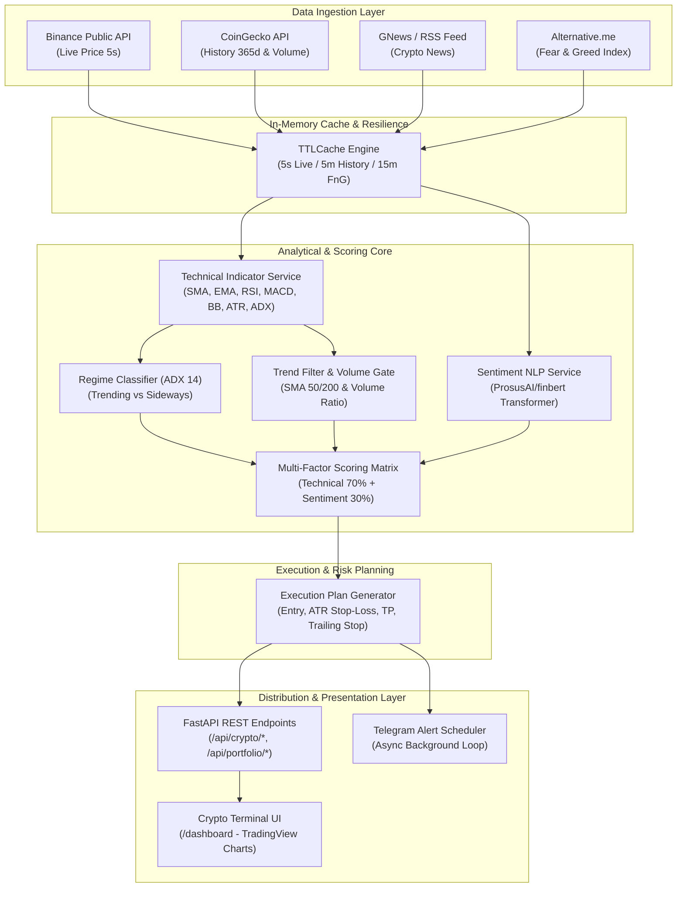

# Recy — Crypto Intelligence Terminal & Quantitative Recommendation Engine

<div align="center">


<p align="center">
  <b>Sistem Analisis Cryptocurrency Kuantitatif Real-Time, Pemodelan Rezim Pasar Adaptif, Analisis Sentimen NLP FinBERT, Eksekusi Risiko Dinamis (ATR Trailing Stop), dan Terminal Dashboard Interaktif.</b>
</p>

[Fitur Utama](#-fitur-utama) •
[Arsitektur Sistem](#-arsitektur-sistem) •
[Scoring & Risk Engine](#-scoring--risk-management-engine) •
[Instalasi & Setup](#-panduan-instalasi--menjalankan-aplikasi) •
[Dokumentasi API](#-dokumentasi-rest-api) •
[Backtesting Suite](#-backtesting--quantitative-research-suite)

</div>

---

## 📌 Ringkasan Eksekutif

**Recy** adalah platform intelijen dan rekomendasi pasar cryptocurrency tingkat lanjut (*Personal Trading & Institutional Research Edition*). Berbeda dengan sistem konvensional yang hanya menyajikan grafik historis atau indikator terisolasi, Recy memadukan:

1. **Analisis Teknikal Multi-Timeframe Berbasis Rezim Pasar (ADX & Trend Filters)**
2. **Pemrosesan Bahasa Alami (NLP) Finansial Menggunakan Model Transformer FinBERT**
3. **Arsitektur Dual-Feed Real-Time (Binance Live Web Ticker 5s + CoinGecko Historical Data)**
4. **Manajemen Risiko Terukur (Level Stop-Loss, Take-Profit, & Trailing Stop Berbasis ATR-14)**
5. **Automated Telegram Alert Dispatcher & Live Web Terminal Dashboard**
6. **Framework Backtesting Kausal Bebas Lookahead Bias (V1–V5 & Walk-Forward Validation)**

---

## 🚀 Fitur Utama

### 1. Dual-Feed Real-Time Market Engine
- **Binance Public API Integration**: Polling harga live dan fluktuasi 24 jam setiap 5 detik dengan in-memory caching untuk responsivitas sub-detik tanpa membebani kuota API.
- **CoinGecko Historical Provider**: Menyuplai riwayat harga penutupan dan volume transaksi hingga 365 hari untuk kalkulasi indikator jangka panjang.
- **Auto-Resolution & Fuzzy Resolver**: Mendukung input pencarian berdasarkan simbol (`btc`, `sol`, `doge`) maupun nama koin (`Bitcoin`, `Solana`).

### 2. Adaptive Regime-Based Scoring Engine
- **Deteksi Rezim Pasar (ADX 14)**:
  - *Trending Market ($ADX \ge 25$)*: Bobot dialihkan dominan ke strategi *Trend Following* (EMA & MACD).
  - *Sideways / Ranging ($ADX < 20$)*: Bobot dialihkan ke osilator *Mean-Reversion* (RSI & Bollinger Bands).
- **Macro Trend Filter Rules**: Mencegah sinyal beli palsu pada tren makro *bearish* (harga di bawah SMA-50 atau SMA-200), dengan proteksi *override oversold* pada pasar *sideways*.
- **Volume Confirmation**: Rasio volume terhadap SMA-20 volume mendeteksi validitas *breakout* dan menyaring *fake pump*.

### 3. Financial NLP Sentiment Analysis
- **FinBERT Architecture (`ProsusAI/finbert`)**: Model transformer spesialisasi keuangan untuk menganalisis judul dan ringkasan berita dari Google News / GNews API ke dalam klasifikasi *positive*, *neutral*, atau *negative*.
- **Crypto Fear & Greed Index Integration**: Pengambilan data sentimen makro pasar harian dari Alternative.me sebagai indikator psikologi pasar dan *fallback*.

### 4. Dynamic Execution & Risk Management Plan
- **ATR Dynamic Stop-Loss**: Dihitung otomatis sebesar $1.5 \times ATR_{14}$ di bawah harga entri.
- **ATR Dynamic Take-Profit**: Target keuntungan terukur sebesar $2.0 \times ATR_{14}$ di atas harga entri ($Risk:Reward \ge 1:1.33$).
- **ATR Trailing Stop Level**: Mengunci profit saat harga menyentuh target pemicu, mengikuti titik tertinggi baru (*Highest Since Entry*).
- **Position Sizing Guidance**: Panduan alokasi modal otomatis (Large-Cap BTC/ETH: 10–15%, Altcoin: 3–5%).

### 5. Automated Telegram Alerts & Scheduler
- **Background Async Scheduler**: Pemindaian berkala otomatis (default: setiap 30 menit) via FastAPI lifespan task.
- **Anti-Spam State Deduplication**: Notifikasi sinyal `BUY` hanya dipicu saat terjadi pergantian status sinyal baru.
- **Trailing Stop Alerts**: Peringatan seketika saat posisi aktif memasuki fase perlindungan profit.

### 6. Interactive Crypto Intelligence Terminal
- Terminal web modern berbasis tema *Obsidian Dark / Cyan Cyber* yang dapat diakses langsung pada `/dashboard`.
- Didukung grafik interaktif **TradingView Lightweight Charts** dengan overlay SMA, Bollinger Bands, indikator volume, dan level entri/SL/TP.
- Jurnal portofolio pribadi live dengan kalkulasi *Floating PnL* dan status keamanan posisi secara *real-time*.

---

## 🏗️ Arsitektur Sistem

Alur pemrosesan data end-to-end dari sumber eksternal hingga visualisasi terminal dan notifikasi:



---

## 📐 Scoring & Risk Management Engine

### 1. Pembobotan Teknis Berdasarkan Rezim Pasar ($ADX_{14}$)

$$Technical\ Score = (w_{trend} \times S_{trend}) + (w_{mom} \times S_{mom}) + (w_{vol} \times S_{vol}) + (w_{volm} \times S_{volm})$$

| Rezim Pasar | Kondisi $ADX_{14}$ | Trend ($w_{trend}$) | Momentum ($w_{mom}$) | Volatilitas ($w_{vol}$) | Volume ($w_{volm}$) |
| :--- | :--- | :---: | :---: | :---: | :---: |
| **TRENDING** | $ADX \ge 25$ | **40%** | **35%** | **10%** | **15%** |
| **SIDEWAYS** | $ADX < 20$ | **15%** | **30%** | **40%** | **15%** |
| **TRANSITION**| $20 \le ADX < 25$ | **30%** | **35%** | **20%** | **15%** |

### 2. Skor Akhir (Multi-Factor Scoring)

$$Final\ Score = (Technical\ Score \times 0.70) + (Sentiment\ Score \times 0.30)$$

- **BUY**: $Final\ Score \ge 65$ *(Wajib lolos Macro Trend Filter: Harga > SMA-50 & SMA-200)*
- **HOLD**: $35 \le Final\ Score < 65$
- **SELL**: $Final\ Score < 35$

### 3. Matriks Eksekusi & Proteksi Modal

| Parameter | Rumus / Metrik | Deskripsi |
| :--- | :--- | :--- |
| **Entry Price** | $\text{Price}_{\text{live}}$ *(Binance Ticker)* | Harga pasar langsung saat sinyal dihasilkan. |
| **Stop-Loss (SL)** | $\text{Entry} - (1.5 \times ATR_{14})$ | Batas toleransi risiko dinamis terhadap volatilitas aset. |
| **Take-Profit (TP)** | $\text{Entry} + (2.0 \times ATR_{14})$ | Target realisasi keuntungan terukur. |
| **Trailing Stop Trigger** | $\text{Entry} + (1.5 \times ATR_{14})$ | Titik harga saat sistem mulai menggeser proteksi profit. |
| **Trailing Stop Level** | $\text{Highest} - (1.5 \times ATR_{14})$ | Level batas pengaman yang terus naik mengikuti puncak harga. |
| **Alokasi Modal** | BTC/ETH: 10–15% \| Altcoin: 3–5% | Proteksi risiko kebangkrutan (*Risk of Ruin*). |

---

## 📁 Struktur Repositori

```text
Recy/
├── app/
│   ├── main.py                          # Inisialisasi FastAPI, lifespan scheduler, dan routing
│   ├── services/
│   │   ├── crypto_service.py            # Integrasi Binance live ticker & CoinGecko historical
│   │   ├── technical_service.py         # Perhitungan SMA, EMA, RSI, MACD, BB, ATR, ADX
│   │   ├── scoring_service.py           # Scoring engine per rezim pasar & trend filters
│   │   ├── recommendation_service.py    # Logika rekomendasi & pembentukan execution plan
│   │   ├── news_service.py              # Pengambilan berita cryptocurrency terkini (GNews)
│   │   ├── sentiment_service.py         # Klasifikasi sentimen FinBERT (HuggingFace)
│   │   ├── sentiment_history_service.py # Pengambilan histori Fear & Greed Index
│   │   ├── portfolio_service.py         # Manajemen posisi portofolio & live floating PnL
│   │   ├── telegram_service.py          # Notifikasi bot Telegram, formatting, & scheduler loop
│   │   ├── cache_service.py             # In-memory TTLCache engine dengan thread-safe lock
│   │   └── backtest_service.py          # Engine modul backtest internal
│   └── static/
│       ├── index.html                   # Antarmuka Crypto Intelligence Terminal
│       ├── css/style.css                # Desain terminal (Obsidian Dark & Cyber theme)
│       └── js/app.js                    # Logic UI, TradingView chart renderer, & polling 5s
│
├── backtest_results/                    # Hasil riset kuantitatif, metrik CSV, & laporan MD
│   ├── report.md                        # Laporan komprehensif performa V1–V5
│   ├── walk_forward_report.md           # Laporan validasi Walk-Forward (In vs Out of Sample)
│   ├── metrics.csv                      # Rekapitulasi metrik seluruh pengujian
│   └── details/                         # Detail log transaksi harian per aset
│
├── docs/
│   ├── crypto_recommendation_planning.md # Perencanaan arsitektur & spesifikasi teknis
│   └── indikator_teknikal_rationale.md  # Rasionil & justifikasi matematis parameter indikator
│
├── run_backtest.py                      # Skrip eksekusi backtesting kuantitatif (V1–V5)
├── optimize_backtest.py                 # Skrip grid search optimasi parameter threshold & ATR
├── walk_forward_backtest.py             # Skrip validasi out-of-sample (anti-overfitting)
├── run_recy.bat                         # Launcher otomatis Windows untuk server Recy
├── requirements.txt                     # Daftar dependensi Python
├── .env.example                         # Contoh konfigurasi environment variables
└── README.md                            # Dokumentasi utama proyek
```

---

## 🛠️ Panduan Instalasi & Menjalankan Aplikasi

### 1. Prasyarat Sistem
- **Python**: Versi 3.11 atau lebih baru
- **Git**: Terpasang di sistem
- **Koneksi Internet**: Diperlukan untuk inisialisasi awal model FinBERT dari Hugging Face (~440 MB)

### 2. Kloning Repositori
```bash
git clone https://github.com/DreamlandSR/Recy.git
cd Recy
```

### 3. Penyiapan Virtual Environment
- **Windows (PowerShell):**
  ```powershell
  python -m venv .venv
  .\.venv\Scripts\Activate.ps1
  ```
- **Linux / macOS:**
  ```bash
  python3 -m venv .venv
  source .venv/bin/activate
  ```

### 4. Instalasi Dependensi
```bash
python -m pip install --upgrade pip
pip install -r requirements.txt
```

> **Catatan:** Dependensi mencakup `torch` dan `transformers`. Pada eksekusi pertama analisis sentimen, library akan mengunduh model `ProsusAI/finbert` secara otomatis ke cache lokal Anda.

### 5. Konfigurasi Environment Variables
Salin file `.env.example` menjadi `.env`:
```bash
cp .env.example .env
```

Sesuaikan konfigurasi di dalam file `.env`:
```env
APP_NAME=Recy
APP_ENV=development
APP_VERSION=0.1.0

# Market Data API Keys
COINGECKO_API_KEY=your_coingecko_api_key_here
GNEWS_API_KEY=your_gnews_api_key_here

# Telegram Notification (Opsional)
TELEGRAM_BOT_TOKEN=your_bot_token_from_botfather
TELEGRAM_CHAT_ID=your_telegram_chat_id
ALERT_INTERVAL_MINUTES=30
```

### 6. Menjalankan Server Aplikasi
Jalankan menggunakan Uvicorn:
```bash
python -m uvicorn app.main:app --reload --host 127.0.0.1 --port 8000
```
*Atau klik dua kali file [run_recy.bat](file:///c:/Project/Magang/Recy/run_recy.bat) pada sistem operasi Windows.*

Aplikasi dapat diakses melalui browser:
- 📊 **Crypto Terminal Dashboard**: [http://127.0.0.1:8000/dashboard](http://127.0.0.1:8000/dashboard)
- 📖 **Interactive Swagger UI**: [http://127.0.0.1:8000/docs](http://127.0.0.1:8000/docs)
- 📑 **Alternative ReDoc**: [http://127.0.0.1:8000/redoc](http://127.0.0.1:8000/redoc)

---

## 📡 Dokumentasi REST API

### Ringkasan Endpoint

| Kategori | Metode | Endpoint | Deskripsi |
| :--- | :---: | :--- | :--- |
| **System** | `GET` | `/` | Health check dan informasi versi API |
| **Terminal** | `GET` | `/dashboard` | Menampilkan antarmuka Crypto Intelligence Terminal |
| **Watchlist** | `GET` | `/api/crypto/dashboard/watchlist` | Data agregat koin pantauan, live ticker, sinyal, dan level SL/TP |
| **Live Price** | `GET` | `/api/crypto/live-prices` | Polling cepat (5 detik) harga Binance & eksekusi real-time |
| **Market** | `GET` | `/api/crypto/markets` | Ringkasan top koin pasar dari CoinGecko |
| **Detail** | `GET` | `/api/crypto/{coin_id}` | Metadata lengkap spesifik koin |
| **History** | `GET` | `/api/crypto/{coin_id}/history` | Riwayat harga harian (`?days=7/30/90/365`) |
| **Technical** | `GET` | `/api/crypto/{coin_id}/technical` | Deret lengkap indikator teknikal historis |
| **Technical Score** | `GET` | `/api/crypto/{coin_id}/technical/score` | Skor teknikal terkini beserta klasifikasi rezim ADX |
| **Recommendation** | `GET` | `/api/crypto/{coin_id}/recommendation` | Sinyal rekomendasi terperinci beserta rencana eksekusi ATR |
| **News** | `GET` | `/api/crypto/{coin_id}/news` | Berita terkini terkait aset dari provider berita |
| **Sentiment** | `GET` | `/api/crypto/{coin_id}/sentiment` | Hasil analisis sentimen NLP FinBERT per artikel |
| **Comprehensive** | `GET` | `/api/crypto/{coin_id}/analysis` | Analisis menyeluruh (Teknikal + Sentimen + Eksekusi) |
| **Fear & Greed** | `GET` | `/api/market/fng` | Nilai dan klasifikasi Crypto Fear & Greed Index terkini |
| **Portfolio** | `GET` | `/api/portfolio/positions` | Menampilkan portofolio aktif beserta live floating PnL |
| **Portfolio** | `POST` | `/api/portfolio/positions` | Menambahkan catatan entri posisi trading baru |
| **Portfolio** | `DELETE`| `/api/portfolio/positions/{id}` | Menghapus atau menutup posisi pada portofolio |
| **Alerts** | `POST` | `/api/alerts/telegram/test` | Menguji konektivitas bot Telegram pengguna |
| **Alerts** | `POST` | `/api/alerts/telegram/scan` | Memicu pemindaian sinyal BUY manual dan dispatch ke Telegram |

### Contoh Respon API

#### Endpoint: `GET /api/crypto/bitcoin/recommendation`
```json
{
  "coin_id": "bitcoin",
  "price_source": "binance",
  "change_24h_pct": 2.45,
  "technical": {
    "trend_score": 100.0,
    "momentum_score": 70.0,
    "volatility_score": 50.0,
    "volume_score": 75.0,
    "has_volume": true,
    "adx_14": 28.42,
    "regime": "TRENDING",
    "trend_filter_ok": true,
    "technical_score": 74.25,
    "condition": "BULLISH"
  },
  "recommendation": {
    "technical_score": 74.25,
    "condition": "BULLISH",
    "recommendation": "BUY",
    "execution": {
      "current_price": 96250.0,
      "price_source": "binance",
      "stop_loss_price": 93450.0,
      "take_profit_price": 99980.0,
      "trailing_stop_trigger": "Trigger saat harga >= 99050.0 (+2.9% dari entry)...",
      "risk_reward_ratio": "1 : 1.33",
      "suggested_allocation_pct": "10-15%"
    }
  }
}
```

---

## 🧪 Backtesting & Quantitative Research Suite

Recy dilengkapi kerangka kerja pengujian historis *strictly causal* (bebas *lookahead bias*):

- **Aturan Anti-Lookahead**: Sinyal di hari $T$ hanya menggunakan data $\le T$, dan dieksekusi pada harga pembukaan hari $T+1$.
- **Prioritas Risiko**: Pemicuan Stop-Loss/Take-Profit dievaluasi lebih dulu dibandingkan sinyal pergantian posisi.
- **Biaya Transaksi**: Memperhitungkan *fee drag* realistis sebesar 0.1% per transaksi beli/jual.

### Menjalankan Pengujian

```bash
# 1. Jalankan pengujian penuh V1–V5 pada aset utama
python run_backtest.py

# 2. Jalankan grid-search optimasi parameter threshold & ATR multiplier
python optimize_backtest.py

# 3. Jalankan validasi Walk-Forward (180 hari Latih vs 91 hari Uji)
python walk_forward_backtest.py
```

### Ringkasan Strategi Pengujian (V1–V5)

| Versi | Basis Sinyal | Pengaturan Biaya | Fitur Tambahan |
| :---: | :--- | :---: | :--- |
| **V1** | Murni Analisis Teknikal | 0.0% | Baseline teknikal tanpa friksi pasar |
| **V2** | Murni Analisis Teknikal | 0.1% | Mengukur dampak nyata *fee drag* |
| **V3** | Murni Sentimen Fear & Greed | 0.1% | Pengujian psikologi pasar makro |
| **V4** | Hibrida (70% Teknikal + 30% Sentimen) | 0.1% | FinBERT per koin dengan FNG fallback |
| **V5** | Pengujian Lintas Aset (Multi-Asset) | 0.1% | Validasi performa pada BTC, ETH, SOL, BNB, & XRP |

*Laporan komprehensif metrik evaluasi dapat ditinjau di [backtest_results/report.md](file:///c:/Project/Magang/Recy/backtest_results/report.md).*

---

## ⚙️ Variabel Lingkungan (.env Reference)

| Variabel | Tipe | Wajib | Nilai Bawaan | Deskripsi |
| :--- | :---: | :---: | :---: | :--- |
| `APP_NAME` | String | Tidak | `Recy` | Nama identitas aplikasi |
| `APP_ENV` | String | Tidak | `development` | Environment runtime (`development`/`production`) |
| `APP_VERSION` | String | Tidak | `0.1.0` | Versi rilis sistem Recy |
| `COINGECKO_API_KEY` | String | Ya | - | Kunci API CoinGecko (Demo / Pro) |
| `GNEWS_API_KEY` | String | Opsional | - | Kunci API GNews untuk ekstraksi berita spesifik aset |
| `TELEGRAM_BOT_TOKEN`| String | Opsional | - | Token autentikasi bot dari Telegram @BotFather |
| `TELEGRAM_CHAT_ID` | String | Opsional | - | ID percakapan atau grup tujuan notifikasi sinyal |
| `ALERT_INTERVAL_MINUTES` | Float | Tidak | `30` | Interval waktu siklus pemindaian sinyal otomatis (menit) |

---

## ⚠️ Disclaimer

> [!WARNING]
> Seluruh algoritma, analisis teknikal, klasifikasi sentimen, dan parameter eksekusi yang disajikan oleh sistem **Recy** dikembangkan secara independen semata-mata untuk tujuan riset kuantitatif, edukasi teknologi perangkat lunak, dan eksplorasi data.
> 
> Rekomendasi (*BUY / HOLD / SELL*) dan level risiko **bukan merupakan nasihat keuangan (*financial advice*), anjuran investasi, maupun ajakan spekulasi**. Pasar cryptocurrency memiliki volatilitas dan risiko kehilangan modal yang tinggi. Pengguna bertanggung jawab penuh atas setiap keputusan finansial masing-masing (*Do Your Own Research*).

---

<div align="center">
  <sub>Dikembangkan dengan dedikasi untuk keunggulan analitik kuantitatif. Hak Cipta &copy; 2026 Recy Team.</sub>
</div>
